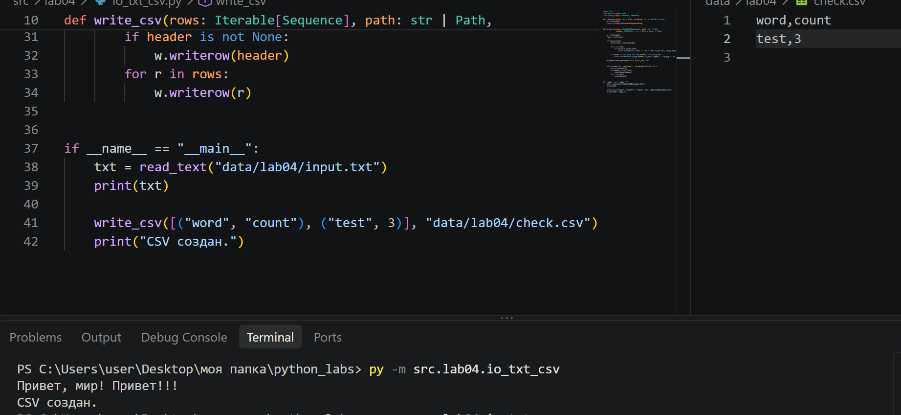

# ЛР4 — Файлы: TXT/CSV и отчёты по текстовой статистике

## Задание A 

Реализует функции для работы с файлами: чтение текстового файла целиком в указанной кодировке (utf-8). Ошибки отсутствия файла (FileNotFoundError) или несовпадения кодировки (UnicodeDecodeError) не перехватываются, чтобы «всплывать» в вызывающий скрипт. Перед записью write_csv проверяет, что все строки в rows имеют одинаковую длину (если задан header, что его длина совпадает с длиной строк), если нет -  ValueError. Родительская папка для выходного файла создаётся автоматически, если её ещё нет. 

## Задание B 

Скрипт пытается прочесть входной файл input.txt через функцию read_text(). При отсутствии файла выводится: "Ошибка: файл не найден" и выполнение функции завершается через return. Прочитанная строка передается в функцию normalize() (приведение к единому регистру, замена ё на е и очистка от лишних спецсимволов). Результат передается в tokenize() (разбиения текста на список слов-токенов). Функция count_freq() собирает токены в частотный словарь. Вычисляется общее количество слов (len(tokens)) и  число уникальных (len(freq)). Функция top_n() извлекает 5 самых частотных элементов.
Отсортированный массив all_rows передается в функцию write_csv(), которая записывает его на диск по пути report.csv с колонками word,count.

## Политика для краевых случаев
Отсутствие входного файла (FileNotFoundError). Если указанный файл по заданному пути не существует, программа прерывает выполнение, выводит в консоль понятное сообщение об ошибке вида: "Ошибка: Файл не найден" и завершает работу.
Сбой декодирования (UnicodeDecodeError). Если кодировка файла не соответствует заданной (utf-8), программа завершается с сообщением о необходимости явного указания параметра --encoding.
Обработка пустого файла. При передаче абсолютно пустого файла выводится статистика о нулевом количестве слов, а в CSV-файле сохраняется строка (word,count) без контента.
Валидация CSV-строк. В модуле io_txt_csv.py встроена проверка структуры данных. Если переданный двумерный массив содержит строки разной длины - ValueError.

## Способ запуска text_report.py

Запуск выполняется из корня репозитория (там, где лежит папка src/), с помощью флага -m:

    python -m src.lab04.text_report

## Пример

**Вход** (data/lab04/input.txt):

    Привет, мир! Привет!!!

**Консоль**

    Всего слов: 3
    Уникальных слов: 2
    Топ-5:
    привет: 2
    мир: 1

**Отчет** (data/lab04/report.csv):

    word,count
    привет,2
    мир,1