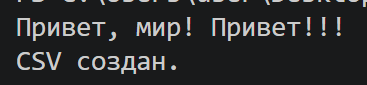
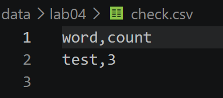
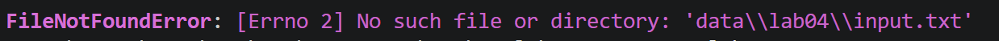
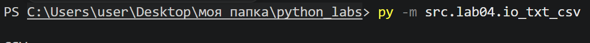
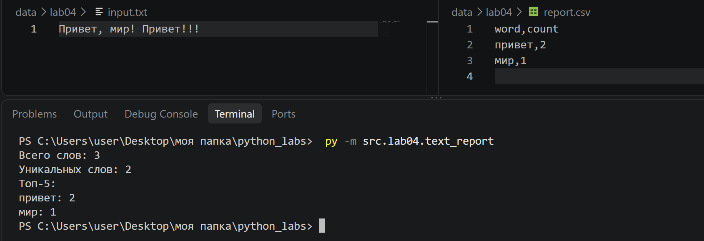
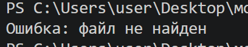
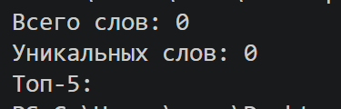
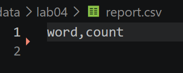

# ЛР4 — Файлы: TXT/CSV и отчёты по текстовой статистике

## Задание A 

### read_text

Реализует функции для работы с файлами: чтение текстового файла целиком в указанной кодировке (utf-8). Ошибки отсутствия файла (FileNotFoundError) или несовпадения кодировки (UnicodeDecodeError) не перехватываются, чтобы «всплывать» в вызывающий скрипт.

    def read_text(path: str | Path, encoding: str = "utf-8") -> str:

        """
        Читает текстовый файл и возвращает содержимое одной строкой
        
        Args:
            path: Путь к файлу в виде строки или объекта Path.
            encoding: Кодировка файла. По умолчанию UTF-8. 
                    Для файлов в другой кодировке можно указать, например, encoding='cp1251'
                
        Returns:
            Содержимое файла в виде строки
        
        Raises:
            FileNotFoundError: Если файл не найден.
            UnicodeDecodeError: Если содержимой файла невозможно декодировать в указанной кодировке"""
        
        p = Path(path)
        return p.read_text(encoding=encoding)

### write_csv

Перед записью write_csv проверяет, что все строки в rows имеют одинаковую длину (если задан header, что его длина совпадает с длиной строк), если нет -  ValueError. Родительская папка для выходного файла создаётся автоматически, если её ещё нет. 

    def write_csv(rows: Iterable[Sequence], path: str | Path,
                header: tuple[str, ...] | None = None) -> None:

        """
        Записывает строки rows в CSV-файл path с разделителем ",".

        Если указан header - он записывается первой строкой файла.

        Файл создаётся заново (если его не было) либо полностью
        перезаписывается (если уже существовал).

        Перед записью проверяется, что все строки в rows имеют одинаковую длину. Если нет - ValueError.
        Если header задан, его длина должна совпадать с длиной строк.

        Если rows пуст и header=None - создаётся пустой файл (0 строк).
        Если rows пуст, а header задан - в файле будет только заголовок.

        """
        p = Path(path)
        rows = list(rows)

        if len(rows)>0:
            first_rows = len(rows[0])

            for r in rows:
                if len(r)!= first_rows:
                    raise ValueError ("Все строки в rows должны быть одной длины")

            if header is not None and len(header) != first_rows:
                raise ValueError("Длина header должна совпадать с длиной строк в rows")

        # создаём родительскую папку, если её ещё нет
        p.parent.mkdir(parents=True, exist_ok=True)

        with p.open("w", newline="", encoding="utf-8") as f:
            w = csv.writer(f)
            if header is not None:
                w.writerow(header)
            for r in rows:
                w.writerow(r)

### Тест

    if __name__ == "__main__":
        txt = read_text("data/lab04/input.txt")
        print(txt)

        write_csv([("word", "count"), ("test", 3)], "data/lab04/check.csv")
        print("CSV создан.")

## Задание B 

Скрипт пытается прочесть входной файл input.txt через функцию read_text(). При отсутствии файла выводится: "Ошибка: файл не найден" и выполнение функции завершается через return. Прочитанная строка передается в функцию normalize() (приведение к единому регистру, замена ё на е и очистка от лишних спецсимволов). Результат передается в tokenize() (разбиения текста на список слов-токенов). Функция count_freq() собирает токены в частотный словарь. Вычисляется общее количество слов (len(tokens)) и  число уникальных (len(freq)). Функция top_n() извлекает 5 самых частотных элементов.
Отсортированный массив all_rows передается в функцию write_csv(), которая записывает его на диск по пути report.csv с колонками word,count.

    from src.lib.text import normalize, tokenize, count_freq, top_n
    from src.lab04.io_txt_csv import read_text, write_csv

    def main():
        try:
            raw_text = read_text("data/lab04/input.txt", encoding="utf-8")
        except FileNotFoundError:
            print("Ошибка: файл не найден")
            return

        normalized_text = normalize(raw_text)
        tokens = tokenize(normalized_text)
        total_words = len(tokens)
        freq = count_freq(tokens)
        unique_words = len(freq)

        all_rows = sorted(freq.items(), key=lambda x: (-x[1], x[0]))
        top5 = top_n(freq, n=5)

        write_csv(all_rows, "data/lab04/report.csv", header=("word", "count"))

        print(f"Всего слов: {total_words}")
        print(f"Уникальных слов: {unique_words}")
        print("Топ-5:")
        for word, count in top5:
            print(f"{word}: {count}")

## Политика для краевых случаев
Отсутствие входного файла (FileNotFoundError). Если указанный файл по заданному пути не существует, программа прерывает выполнение, выводит в консоль понятное сообщение об ошибке вида: "Ошибка: Файл не найден" и завершает работу.

Сбой декодирования (UnicodeDecodeError). Если кодировка файла не соответствует заданной (utf-8), программа завершается с сообщением о необходимости явного указания параметра --encoding.

Обработка пустого файла. При передаче абсолютно пустого файла выводится статистика о нулевом количестве слов, а в CSV-файле сохраняется строка (word,count) без контента.

Валидация CSV-строк. В модуле io_txt_csv.py встроена проверка структуры данных. Если переданный двумерный массив содержит строки разной длины - ValueError.

Большие файлы. ТЗ подразумевает полное считывание файла в оперативную память одной строкой. При обработке очень больших данных в реальных условиях рекомендуется преобразовать логику чтения на построчный вид.

## Способ запуска text_report.py

Запуск выполняется из корня репозитория (там, где лежит папка src/), с помощью флага -m:

    python -m src.lab04.text_report

## Пример

**Вход** (data/lab04/input.txt):

    Привет, мир! Привет!!!

**Консоль**

    Всего слов: 3
    Уникальных слов: 2
    Топ-5:
    привет: 2
    мир: 1

**Отчет** (data/lab04/report.csv):

    word,count
    привет,2
    мир,1