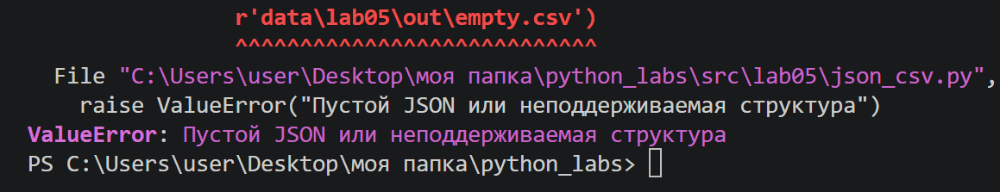
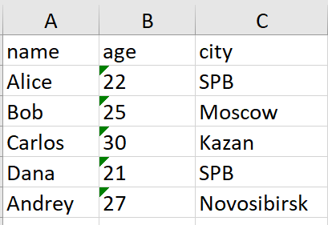

# Отчет по лабораторной работе №5

## Задание A

### Функция json_to_csv

```python
    def json_to_csv(json_path: str, csv_path: str) -> None:
        """
        Преобразует JSON-файл в CSV.
        Поддерживает список словарей [{...}, {...}], заполняет отсутствующие поля пустыми строками.
        Кодировка UTF-8. Порядок колонок — как в первом объекте.
        """
        jp = Path(json_path)
        cp = Path(csv_path)

        if not jp.exists():
            raise FileNotFoundError("Указанный JSON файл не найден")

        if jp.suffix.lower() != '.json':
            raise ValueError("Указанный файл не формата JSON")

        with jp.open('r', encoding='utf-8') as p:
            try:
                data = json.load(p)
            except json.JSONDecodeError:
                raise ValueError("Пустой JSON или неподдерживаемая структура")

        if not isinstance(data, list) or len(data) == 0:
            raise ValueError('Файл JSON пустой или имеет неправильный формат')
        if not all(isinstance(item, dict) for item in data):
            raise ValueError("Все элементы списка JSON должны быть словарями")

        ensure_parent_dir(cp)
        fieldnames = {}
        for element in data:
            for key in element.keys():
                fieldnames[key] = None

        with cp.open('w', newline="", encoding='utf-8') as f:
            w = csv.DictWriter(f, fieldnames=list(fieldnames.keys()))
            w.writeheader()
            w.writerows(data)
```

Функция:

1. Проверяет существование входного файла;
2. Проверяет расширение .json;
3. Читает JSON в кодировке UTF-8;
4. Проверяет, что корневой объект является непустым списком словарей;
5. Собирает названия всех ключей в порядке их первого появления;
6. Записывает заголовок и строки в CSV в кодировке UTF-8.
7. Если в одном из словарей отсутствует ключ, csv.DictWriter записывает в соответствующую ячейку пустое значение.


### Функция csv_to_json
```python
    def csv_to_json(csv_path: str, json_path: str) -> None:
        """
        Преобразует CSV в JSON (список словарей).
        Заголовок обязателен, значения сохраняются как строки.
        """
        jp = Path(json_path)
        cp = Path(csv_path)

        if not cp.exists():
            raise FileNotFoundError("Указанный CSV файл не найден")

        if cp.suffix.lower() != '.csv':
            raise ValueError("Указанный файл не формата CSV")

        with cp.open("r", newline="", encoding="utf-8") as f:
            reader = csv.DictReader(f)
            if reader.fieldnames is None:
                raise ValueError("Файл CSV пустой")

            data = list(reader)

        if not data:
            raise ValueError("Файл CSV не содержит данных")

        ensure_parent_dir(jp)
        with jp.open('w', encoding='utf-8') as p:
            json.dump(data, p, ensure_ascii=False, indent=2)
```

Функция:

1. Проверяет существование входного файла;
2. Проверяет расширение .csv;
3. Читает CSV в кодировке UTF-8;
4. Проверяет наличие заголовка и хотя бы одной строки данных;
5. Преобразует каждую строку в словарь;
6. Сохраняет список словарей в JSON с отступом в два пробела.


### Запуск модуля JSON ↔ CSV
Из корня репозитория:

    python -m src.lab05.json_csv


## Задание B
```python
    def csv_to_xlsx(csv_path: str, xlsx_path: str) -> None:
        """Конвертирует CSV в XLSX.

        Первая строка CSV — заголовок. Лист называется "Sheet1". 
        Ширина каждой колонки равна длине самого длинного значения, но не меньше 8 символов.
        Значения записываются как строки (типы не угадываются).

        Raises:
            FileNotFoundError: входного CSV нет.
            ValueError: неверное расширение, пустой CSV.
        """

        cp = Path(csv_path)
        xlp = Path(xlsx_path)

        if not cp.exists():
            raise FileNotFoundError("Указанный CSV файл не найден")

        if cp.suffix.lower() != '.csv':
            raise ValueError("Указанный файл не формата CSV")

        with cp.open('r', newline='', encoding='utf-8') as f:
            reader = list(csv.reader(f))

        if not reader:
            raise ValueError("Файл CSV пустой")

        wb = Workbook()
        ws = wb.active
        assert ws is not None
        ws.title = "Sheet1"
        for row in reader:
            ws.append(row)

        for col in ws.columns:
            max_len = 0
            letter = col[0].column_letter

            for cell in col:
                if cell.value and len(str(cell.value)) > max_len:
                    max_len = len(str(cell.value))

            ws.column_dimensions[letter].width = max(max_len, 8)

        ensure_parent_dir(xlp)
        wb.save(xlp)
```

Функция:

1. Проверяет существование CSV-файла;
2. Проверяет расширение .csv;
3. Читает строки в кодировке UTF-8;
4. Создаёт книгу Excel с помощью openpyxl;
5. Добавляет строки CSV на лист Sheet1;
6. Рассчитывает ширину столбцов;
7. Сохраняет результат по указанному пути.


### Запуск модуля CSV → XLSX
Из корня репозитория:

    python -m src.lab05.csv_xlsx


## Политика обработки краевых ситуаций и ошибок

FileNotFoundError — входной файл не найден;
ValueError — расширение файла не соответствует ожидаемому формату;
ValueError — JSON пустой, имеет неподдерживаемую структуру или содержит элементы не-словари;
ValueError — CSV пустой или не содержит строк данных.


## Примеры данных и результаты

Для демонстрации используются следующие файлы:

data/samples/people.json — список людей в формате JSON;
data/samples/people.csv — те же данные в формате CSV;
data/samples/cities.csv — дополнительный CSV с городами;

data/out/people_from_json.csv — результат JSON → CSV;
data/out/people_from_csv.json — результат CSV → JSON;
data/out/people.xlsx — результат CSV → XLSX.


## Тест-Кейсы:

## A: JSON → CSV

Входной файл (data/samples/people.json):

    [
    {"name": "Alice", "age": 22, "city": "SPB"},
    {"name": "Bob", "age": 25, "city": "Moscow"},
    {"name": "Carlos", "age": 30, "city": "Kazan"},
    {"name": "Dana", "age": 21, "city": "SPB"},
    {"name": "Andrey", "age": 27, "city": "Novosibirsk"}
    ]

Содержимое созданного файла (data/out/people.csv):

    name,age,city
    Alice,22,SPB
    Bob,25,Moscow
    Carlos,30,Kazan
    Dana,21,SPB
    Andrey,27,Novosibirsk

Ошибка (пустой json файл или неподдерживаемая структура):



## B: CSV → JSON

Входной файл (data/samples/people.csv):

    name,age,city
    Alice,22,SPB
    Bob,25,Moscow
    Carlos,30,Kazan
    Dana,21,SPB
    Andrey,27,Novosibirsk

Содержимое созданного файла (data/out/people.json)

    [
    {
        "name": "Alice",
        "age": "22",
        "city": "SPB"
    },
    {
        "name": "Bob",
        "age": "25",
        "city": "Moscow"
    },
    {
        "name": "Carlos",
        "age": "30",
        "city": "Kazan"
    },
    {
        "name": "Dana",
        "age": "21",
        "city": "SPB"
    },
    {
        "name": "Andrey",
        "age": "27",
        "city": "Novosibirsk"
    }
    ]

## C: CSV → XLSX

Входной файл (data/samples/cities.csv):

    city,country,population
    SPB,Russia,5384342
    Moscow,Russia,13010112
    Kazan,Russia,1306953
    Novosibirsk,Russia,1620162
    Yekaterinburg,Russia,1493749

Результат (data/out/cities.xlsx): 




