# ЛР6 — CLI‑утилиты с argparse (cat/grep‑lite + конвертеры)
## Задание A - файл cli_text.py

Для создания интерфейса командной строки используется стандартный модуль argparse. Программа поддерживает две подкоманды: cat (вывод содержимого файла) и stats (анализ частоты слов).После обработки аргументов через parse_args() вызывается соответствующая функция.

### cat_command
```python
    def cat_command(input_path: str, numbered: bool = False) -> None:
        path = Path(input_path)

        if not path.is_file():
            raise FileNotFoundError("Файл не найден")

        with path.open("r", encoding="utf-8") as file:
            for number, line in enumerate(file, start = 1):
                if numbered:
                    print(f"{number} {line}", end="")
                else:
                    print(line, end="")
```

1. Принимает путь к файлу и необязательный параметр numbered для включения нумерации строк.
2. Проверяет существование файла с помощью Path.is_file().
3. Открывает файл в кодировке UTF-8.
4. Считывает и выводит содержимое построчно.
5. Использует enumerate(file, start=1) для нумерации строк при включённом флаге -n.
6. Параметр end="" предотвращает появление лишних переносов строк.

### stats_command
```python

    def stats_command(input_path: str, top: int = 5) -> None:
        path = Path(input_path)

        if not path.is_file():
            raise FileNotFoundError("Файл не найден")

        with path.open("r", encoding="utf-8") as file:
            text = file.read()

        total, unique, top_words = get_text_stats(text, top)

        print(f'Всего слов: {total}')
        print(f'Уникальных слов: {unique}')
        print(f'Топ-{top}:')

        for w, c in top_words:
            print(f'{w}: {c}')
```

1. Принимает путь к файлу и параметр top (по умолчанию — 5), определяющий количество наиболее частых слов.
2. Проверяет существование входного файла и считывает содержимое файла в кодировке UTF-8.
3. Передаёт текст в функцию get_text_stats() для анализа.
4. Выводит общее количество слов, количество уникальных слов и список наиболее частых слов с указанием их частоты.

### main
```python
    def main():
        parser = argparse.ArgumentParser(description="CLI‑утилиты для обработки текста")
        
        subparsers = parser.add_subparsers(dest = "command", required=True)

        cat_parser = subparsers.add_parser("cat", help="Вывести содержимое файла")
        cat_parser.add_argument("--input", required=True, help="Путь к входному файлу")
        cat_parser.add_argument("-n", action="store_true", help="Нумеровать строки")

        stats_parser = subparsers.add_parser("stats", help="Показать частоты слов")
        stats_parser.add_argument("--input", required=True, help="Путь к входному текстовому файлу")
        stats_parser.add_argument("--top", type=int, default=5, help="Количество самых частых слов")

        args = parser.parse_args()

        if args.command == "stats" and args.top < 1:
            parser.error('--top должен быть больше нуля')

        try: 
            if args.command == "cat":
                cat_command(args.input, args.n)
            elif args.command == "stats":
                stats_command(args.input, args.top)

        except FileNotFoundError:
            parser.error(f"Файл не найден: {args.input}")
        except UnicodeDecodeError:
            parser.error(f'Файл {args.input} не удалось прочитать в кодировке UTF-8')
```

1. Создаёт парсер аргументов с помощью argparse.ArgumentParser().
2. Регистрирует подкоманды cat и stats через add_subparsers().
3. Определяет аргументы каждой команды с помощью add_argument().
4. Для cat задаёт обязательный аргумент --input и флаг -n для нумерации строк.
5. Для stats задаёт обязательный аргумент --input и параметр --top со значением по умолчанию 5.
6. Проверяет, что значение --top больше нуля.
7. Определяет выбранную операцию через args.command и вызывает соответствующую функцию.
8. Обрабатывает ошибки отсутствия файла и чтения в неправильной кодировке UTF-8.

## Запуски

    python -m src.lab06.cli_text cat --input data/samples/people.csv

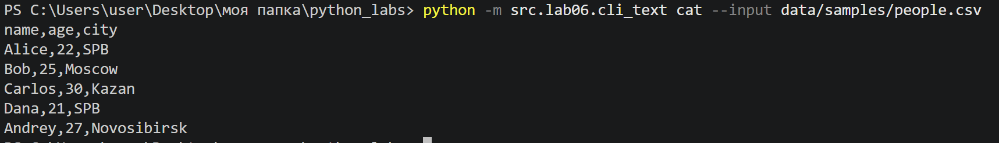

    python -m src.lab06.cli_text cat --input data/samples/people.csv -n

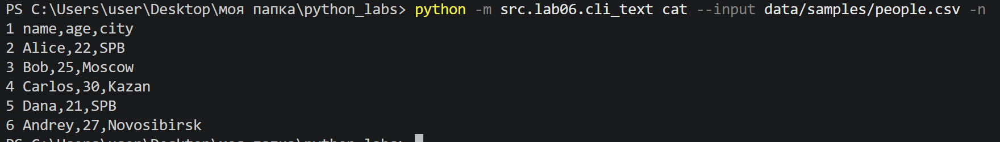

    python -m src.lab06.cli_text stats --input data/samples/people.txt --top 5

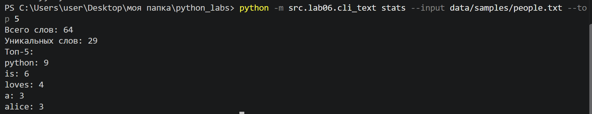

    python -m src.lab06.cli_text stats --input data/samples/people.txt --top 3

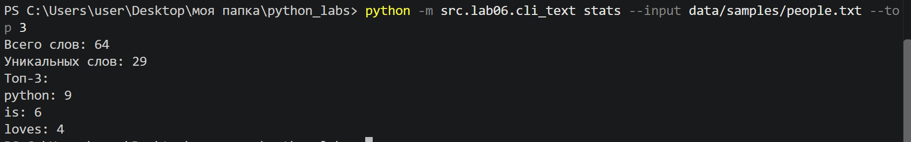

## Задание B - файл cli_convert.py

### main

Предоставляет интерфейс командной строки для функций конвертации файлов, реализованных в ЛР5. Использует стандартный модуль argparse для обработки команд и аргументов. Поддерживает три подкоманды: json2csv, csv2json и csv2xlsx.
```python
    def main():
        parser = argparse.ArgumentParser(description="Конвертеры данных")
        sub = parser.add_subparsers(dest="command", required=True)

        json_parser = sub.add_parser("json2csv", help="Преобразовать JSON‑файл в формат CSV.")
        json_parser.add_argument("--in", dest="input", required=True, help="Путь к входному JSON‑файлу.")
        json_parser.add_argument("--out", dest="output", required=True, help="Путь к выходному CSV‑файлу.")

        csv_parser = sub.add_parser("csv2json", help="Преобразовать CSV‑файл в формат JSON.")
        csv_parser.add_argument("--in", dest="input", required=True, help="Путь к входному CSV‑файлу.")
        csv_parser.add_argument("--out", dest="output", required=True, help="Путь к выходному JSON‑файлу.")

        xlsx_parser = sub.add_parser("csv2xlsx", help="Преобразовать CSV‑файл в формат XLSX.")
        xlsx_parser.add_argument("--in", dest="input", required=True, help="Путь к входному CSV‑файлу.")
        xlsx_parser.add_argument("--out", dest="output", required=True, help="Путь к выходному файлу Excel XLSX.")

        args = parser.parse_args()

        try:
            if args.command == "json2csv":
                json_to_csv(args.input, args.output)
            elif args.command == "csv2json":
                csv_to_json(args.input, args.output)
            elif args.command == "csv2xlsx":
                csv_to_xlsx(args.input, args.output)
        except FileNotFoundError:
            parser.error(f"Файл не найден: {args.input}")
        except ValueError as error:
            parser.error(str(error))
```
1. Создаёт парсер аргументов с помощью argparse.ArgumentParser().
2. Регистрирует три подкоманды через add_subparsers().
3. Для каждой подкоманды определяет два обязательных аргумента: --in (путь к исходному файлу) и --out (путь к выходному файлу).
4. Использует dest="input" и dest="output" для сохранения значений аргументов в соответствующих атрибутах объекта args.
5. Применяет parse_args() для обработки введённых пользователем аргументов.
6. Определяет выбранную подкоманду через args.command и вызывает соответствующую функцию конвертации из ЛР5.
7. Обрабатывает ошибки отсутствия файла (FileNotFoundError) и некорректных данных (ValueError) с помощью parser.error()

## Запуски

    python -m src.lab06.cli_convert json2csv --in data/samples/people.json --out data/out/lab06/people_from_json.csv


    python -m src.lab06.cli_convert csv2json --in data/samples/people.csv --out data/out/lab06/people_from_csv.json

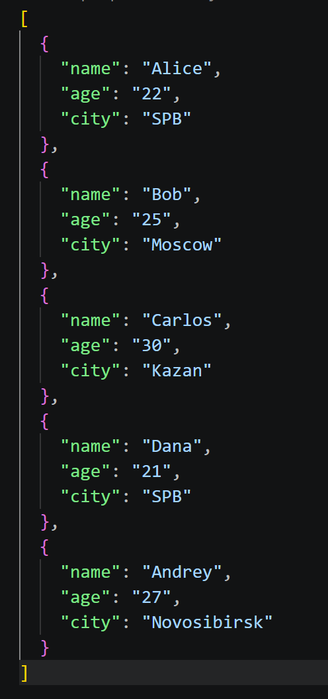

    python -m src.lab06.cli_convert csv2xlsx --in data/samples/people.csv --out data/out/lab06/people.xlsx

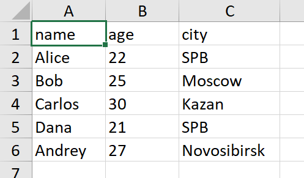

## Обработка ошибок:

### cli_text

Отрицательный --top:

    python -m src.lab06.cli_text stats --input data/samples/people.txt --top -3


Отсутствующий файл:

    python -m src.lab06.cli_text cat --input missing.txt


### cli_convert

Отсутствие обязательных аргументов:

    python -m src.lab06.cli_convert json2csv

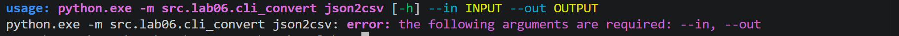

## Проверка --help

### cli_text

    python -m src.lab06.cli_text --help

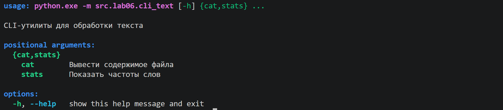

    python -m src.lab06.cli_text cat --help

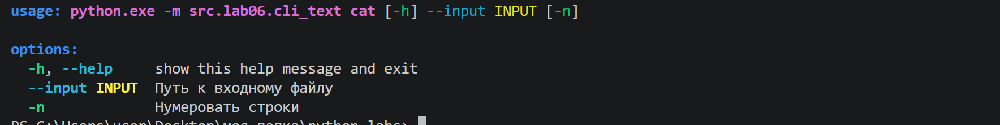

    python -m src.lab06.cli_text stats --help

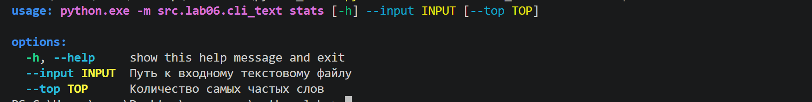

### cli_convert

    python -m src.lab06.cli_convert --help

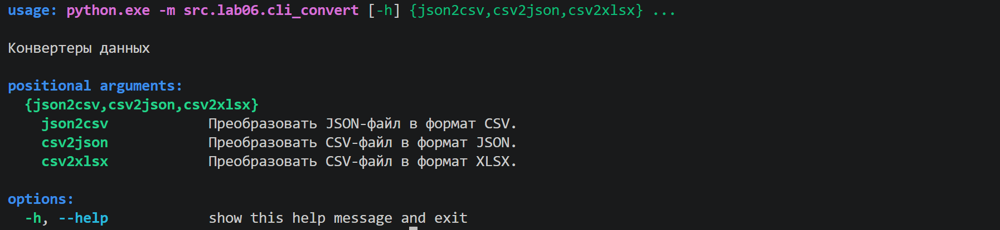

    python -m src.lab06.cli_convert json2csv --help

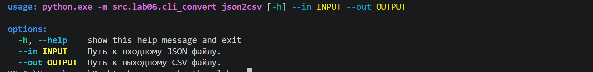