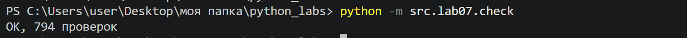
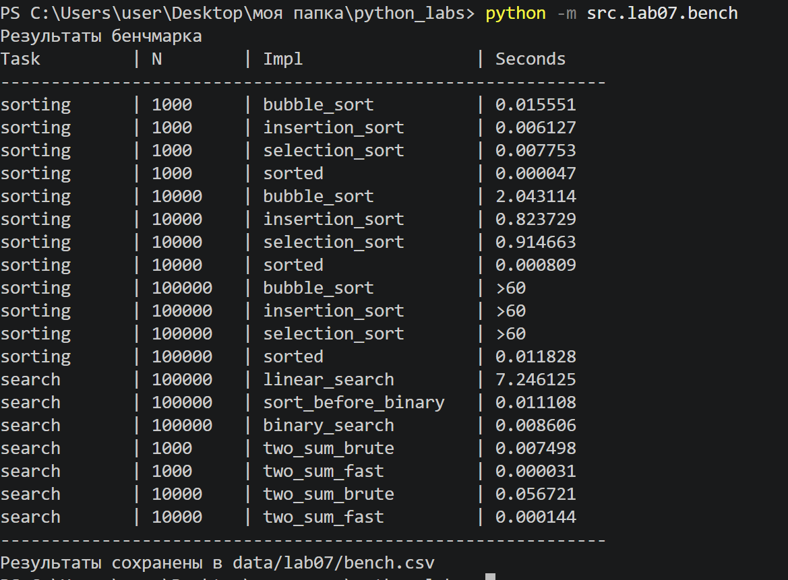
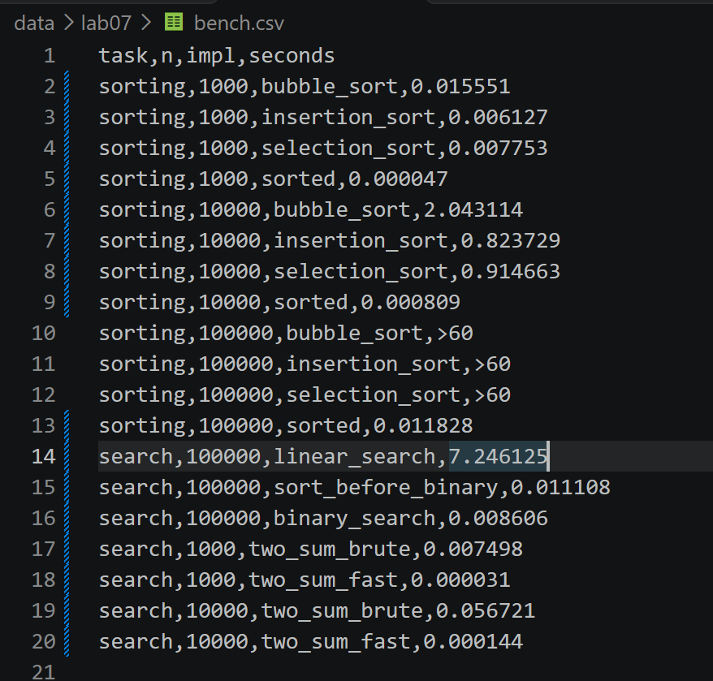

# Лабораторная работа №7

## Задание A. Поиск (search.py)

### linear_search

Последовательно перебирает элементы списка и сравнивает их с искомым числом. Возвращает индекс первого вхождения или -1, если число не найдено.

Сложность: O(n)
``` python
    def linear_search(nums, x):
        """Индекс первого вхождения x или -1.

        linear_search([4, 2, 7, 2], 2) -> 1
        linear_search([4, 2, 7, 2], 9) -> -1
        linear_search([], 1) -> -1
        """
        for i in range(len(nums)):
            if nums[i] == x:
                return i
        return -1
```

### binary_search

Ищет число в отсортированном списке, каждый раз уменьшая область поиска вдвое. Возвращает индекс найденного элемента или -1.

Сложность: O(log n)
``` python
    def binary_search(sorted_nums, x):
        """Индекс x в отсортированном по возрастанию списке или -1.
        На неотсортированном списке результат не определён.

        binary_search([1, 3, 5, 7], 5) -> 2
        binary_search([1, 3, 5, 7], 4) -> -1
        binary_search([5], 5) -> 0
        binary_search([], 5) -> -1
        """
        lo = 0
        hi = len(sorted_nums) - 1
        while lo <= hi:
            mid = (lo + hi) // 2
            if sorted_nums[mid] == x:
                return mid
            elif sorted_nums[mid] < x:
                lo = mid + 1
            else:
                hi = mid - 1
        return -1
```

### two_sum_brute

Перебирает все возможные пары элементов и проверяет, равна ли их сумма target. При нахождении подходящей пары возвращает её индексы, иначе None.

Сложность: O(n^2)
``` python
    def two_sum_brute(nums, target):
        """Пара индексов (i, j), i < j, nums[i] + nums[j] == target, или None.

        two_sum_brute([2, 7, 11, 15], 9) -> (0, 1)
        two_sum_brute([1, 2], 10) -> None
        """
        for i in range(len(nums)):
            for j in range(i + 1, len(nums)):
                if nums[i] + nums[j] == target:
                    return (i, j)
        return None
```

### two_sum_fast

За один проход по списку ищет нужную пару с помощью словаря seen. Для каждого элемента вычисляет, какое число нужно для получения target, и проверяет, встречалось ли оно раньше.

Сложность: O(n)
``` python
    def two_sum_fast(nums, target):
    """То же, что two_sum_brute, но за один проход со словарём."""
    seen = {}  # значение: индекс
    for i in range(len(nums)):
        need = target - nums[i]
        if need in seen:
            return (seen[need], i)
        seen[nums[i]] = i
    return None
```

## Задание B. Сортировки (sorting.py)

### bubble_sort

Сравнивает соседние элементы и меняет их местами, если они стоят в неправильном порядке.  Повторяет проходы до завершения сортировки. 

Сложность: O(n^2) 
``` python
    def bubble_sort(nums):
        """Новый список, отсортированный по возрастанию. Исходный не меняется.

        bubble_sort([3, 1, 2]) -> [1, 2, 3]
        bubble_sort([2, 2, 1]) -> [1, 2, 2]
        bubble_sort([]) -> []
        """
        result = nums.copy()
        n = len(result)
        for i in range(n):
            for j in range(0, n - i - 1):
                if result[j] > result[j + 1]:
                    result[j], result[j + 1] = result[j + 1], result[j]
        return result
```

### insertion_sort

Последовательно берет элементы списка и вставляет каждый на нужное место среди уже отсортированных элементов.

Сложность: O(n^2), O(n) для уже отсортированного
``` python
    def insertion_sort(nums):
    """Возвращает отсортированный список методом сортировки вставками. Исходный не меняется."""
    rez = nums.copy()
    for i in range(1, len(rez)):
        current = rez[i]
        j = i - 1
        while j >= 0 and rez[j] > current:
            rez[j + 1] = rez[j]
            j -= 1
        rez[j + 1] = current
    return rez
```

### selection_sort

На каждом шаге ищет минимальный элемент в неотсортированной части списка и ставит его на текущую позицию. 

Сложность: O(n^2)
```python
    def selection_sort(nums):
    """Возвращает отсортированный список методом сортировки выбором. Исходный не меняется."""
    rez = nums.copy()
    n = len(rez)
    for i in range(n - 1):
        min_index = i
        for j in range(i + 1, n):
            if rez[j] < rez[min_index]:
                min_index = j
        rez[i], rez[min_index] = rez[min_index], rez[i]
    return rez
```

## Задание C. Проверка против эталона (check.py)

### Импортируемые функции и библиотеки
- random - библиотека, для генерации случайных чисел. Используется при генерации списков и чисел для проверок.
- src.lab07.sorting import (...) - функции сортировок.
- src.lab07.search (...) - функции поиска.
```python
    import random
    from src.lab07.sorting import bubble_sort, insertion_sort, selection_sort
    from src.lab07.search import linear_search, binary_search, two_sum_brute, two_sum_fast
```
### check_sorting

Проверяет сортировки на случайных списках, сравнивает результат с sorted() и проверяет сохранность исходного списка. При расхождении поднимается AssertionError с данными, на которых оно случилось.
```python
    def check_sorting(fn, trials=100):
    k = 0
    for _ in range(trials):
        n = random.randint(0, 50)
        nums = [random.randint(-100, 100) for _ in range(n)]
        original = nums.copy()
        result = fn(nums)

        assert result == sorted(nums), f"{fn.__name__} ошибься на {nums}: {result}"
        assert nums == original, f"{fn.__name__} изменил исходный список"
        k +=1
    return k
```

### check_search 

Проверяет линейный и бинарный поиск на случайных списках, сравнивая результаты с ожидаемыми. При расхождении поднимается AssertionError с данными, на которых оно случилось.
```python
    def check_search(trials=100):
    """
    Проверяет linear_search и binary_search на случайных примерах
    """
    k = 0

    for _ in range(trials):
        n = random.randint(0, 50)
        nums = [random.randint(-100, 100) for _ in range(n)]
        x = random.randint(-100, 100)

        # linear_search
        try:
            lin_p = nums.index(x)
        except ValueError:
            lin_p = -1

        assert linear_search(nums, x) == lin_p, (
            f"linear_search ошиблась в поиске {x} на {nums}"
        )
        k += 1

        # binary_search
        sorted_nums = sorted(nums)
        bin_p = binary_search(sorted_nums, x)

        if x in sorted_nums:
            assert bin_p != -1 and sorted_nums[bin_p] == x, (
                f"binary_search ошиблась на {sorted_nums}, искали {x}: {bin_p}"
            )
        else:
            assert bin_p == -1, (
                f"binary_search нашел отсутствующий элемент {x}"
            )
        k += 1

        if sorted_nums:
            for i in (sorted_nums[0], sorted_nums[-1]):
                bin_p = binary_search(sorted_nums, i)

                assert bin_p != -1 and sorted_nums[bin_p] == i, (
                    f"binary_search не нашла крайний элемент {i}"
                )
                k += 1

    return k
```

### check_two_sum

Проверяет оба алгоритма поиска пары чисел и правильность полученных результатов. При расхождении поднимается AssertionError с данными, на которых оно случилось.
``` python
    def check_two_sum(trials=100):
    k = 0
    for _ in range(trials):
        n = random.randint(0, 50)
        nums = [random.randint(-100, 100) for _ in range(n)]
        target = random.randint(-200, 200)

        brute = two_sum_brute(nums, target)
        fast = two_sum_fast(nums, target)

        if brute is None or fast is None:
            assert brute == fast, f"Функции дали разный результат при поиске {target} в {nums}"
        else:
            assert nums[brute[0]] + nums[brute[1]] == target, (
                f"two_sum_brute ошиблась на {nums}, искали {target}"
            )
            assert nums[fast[0]] + nums[fast[1]] == target, (
                f"two_sum_fast ошиблась на {nums}, искали {target}"
            )
        k += 1
    return k
```

### main

Релизован подсчет общего числа проверок + выводится подтверждение, что все n проверок пройдены.
```python
    if __name__== "__main__":
        random.seed(42)
        n=0
        
        for fn in (bubble_sort, insertion_sort, selection_sort):
            n += check_sorting(fn)
        
        n += check_search()
        
        n += check_two_sum()
        
        print(f"OK, {n} проверок")
```

### Запуск:

    python -m src.lab07.check

### Вывод:



## Задание D. Бенчмарк (bench.py)

### Импортируемые функции и библиотеки

- CSV - необходимая библиотека для оформления вывода бенчмарка.
- timeit - библиотека, чтобы замерить время выполнения сортировок и поиска.
- random - библиотека, чтобы генерировать случайные числа. Используется в создании рандомных списков и чисел для проверки.
- write_csv - функция, чтобы оформить данные в csv файл.
- src.lab07.search (...) - функции поиска.
- src.lab07.sorting (...) - функции сортировок.
``` python
    import random
    import timeit
    import csv
    from src.lab04.io_txt_csv import write_csv
    from src.lab07.search import linear_search, binary_search, two_sum_brute, two_sum_fast
    from src.lab07.sorting import bubble_sort, insertion_sort, selection_sort
```
### read_numbers

Считывает данные из csv и возвращает список.
```python
    def read_numbers(path):
        ''' Считывает данные из csv и возвращает список'''
        with open(path, encoding="utf-8") as f:
            return [int(row["value"]) for row in csv.DictReader(f)]
```

### generate_samples

Генерирует три списка длинной (1000, 10000, 100000) с случайными числами и записывает их в три файла csv.
```python
    def generate_samples():
        ''' Создаёт списки случайных чисел и сохраняет их в CSV-файлы '''
        sizes = (1000,10000,100000)
        for n in sizes:
            nums = [random.randint(-1_000_000,1_000_000) for _ in range(n)]
            rows = [[x] for x in nums]
            write_csv(rows,f'data/lab07/samples/{n}_sort.csv',header=('value',))
```

### bench_sorts

Считывает данные из csv файлов, измеряет время сортировок с помощью timeit. Результат сохраняется в списке с кортежами данных.
```python
    def bench_sorts():
        rows = []
        for n in (1_000, 10_000, 100_000):
            data = read_numbers(f'data/lab07/samples/{n}_sort.csv')

            funcs = [
                ("bubble_sort", bubble_sort),
                ("insertion_sort", insertion_sort),
                ("selection_sort", selection_sort),
                ("sorted", sorted)
            ]

            for name, sort_func in funcs:
                if n <= 10_000 or name == "sorted":
                    time = timeit.timeit(lambda: sort_func(data), number=1)
                    rows.append(("sorting", n, name, f"{time:.6f}"))
                else:
                    rows.append(("sorting", n, name, ">60"))

        return rows
```

### bench_search

Измеряет время линейного, бинарного поиска и двух вариантов two_sum с помощью timeit. Полученные данные записываются в кортежи, а потом объединяются в список.
```python
def bench_search():
    rows=[]
    data = read_numbers(f'data/lab07/samples/100000_sort.csv')
    targets = [random.choice(data) for _ in range(10_000)]

   
    time_l_search = timeit.timeit(lambda: [linear_search(data,t) for t in targets],  number =1)
    rows.append(("search", 100_000, "linear_search", f"{time_l_search:.6f}"))

   
    time_sb_binary=timeit.timeit(lambda: sorted(data), number=1)
    rows.append(("search", 100_000, "sort_before_binary", f"{time_sb_binary:.6f}"))
    sorted_data= sorted(data)

    time_b_search = timeit.timeit(lambda: [binary_search(sorted_data,t) for t in targets],  number =1)
    rows.append(("search", 100_000, "binary_search", f"{time_b_search:.6f}"))

    
    for n in (1_000,10_000):
        data_ts = read_numbers(f'data/lab07/samples/{n}_sort.csv')
        a, b = random.sample(data_ts, 2)
        target = a+b

        time_tsb = timeit.timeit(lambda: two_sum_brute(data_ts,target), number=1)
        rows.append(("search", n, "two_sum_brute", f"{time_tsb:.6f}"))

        time_tsf = timeit.timeit(lambda: two_sum_fast(data_ts,target), number=1)
        rows.append(("search", n, "two_sum_fast", f"{time_tsf:.6f}"))

    return rows
```

### main

Объединяет все полученные данные из предыдущих функций в общий csv файл и выводит эти же данные в виде таблицы в терминал.
```python
    def main():
        random.seed(42)
        generate_samples()

        header = ("task", "n", "impl", "seconds")
        rows = []

        rows.extend(bench_sorts())
        rows.extend(bench_search())

        write_csv(rows, 'data/lab07/bench.csv', header)

        print("Результаты бенчмарка")
        print(f"{'Task':<12} | {'N':<8} | {'Impl':<20} | {'Seconds':<12}")
        print('-' * 60)

        for task, n, impl, seconds in rows:
            print(f"{task:<12} | {n:<8} | {impl:<20} | {seconds:<12}")

        print('-' * 60)
        print("Результаты сохранены в data/lab07/bench.csv")


    if __name__ == "__main__":
        main()
```

### Запуск:

    python -m src.lab07.bench

### Терминал:



###  bench.csv:





## Вывод по лабораторной работе

**Сортировки и поиск**
 При увеличении размера списка с 1 000 до 10 000 элементов Bubble Sort замедлился примерно в 131 раз (с 0,015551 до 2,043114 с), что соответствует ожидаемой сложности (O(n^2)). Время работы sorted выросло примерно в 17,2 раза (с 0,000047 до 0,000809 с), что соответствует (O(n \log n)). На 100 000 элементов квадратичные сортировки не запускались из-за ограничения в 60 секунд.

Бинарный поиск нельзя применять к неотсортированному списку, так как он использует порядок элементов для отбрасывания половины списка. На 100 000 элементах линейный поиск занял 7,246125 с, а сортировка и бинарный поиск вместе — около 0,019714 с. Поэтому при большом количестве запросов предварительная сортировка выгоднее, а для одного поиска лучше использовать линейный поиск.

**Two Sum** При 10 000 элементах полный перебор занял 0,056721 с, а быстрое решение — 0,000144 с, что показывает преимущество оптимизированного алгоритма.

**Проверка правильности** Скрипт check.py выполнил 794 проверки и не обнаружил ошибок. Все алгоритмы прошли тестирование, поэтому исправления не потребовались.

