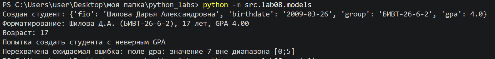
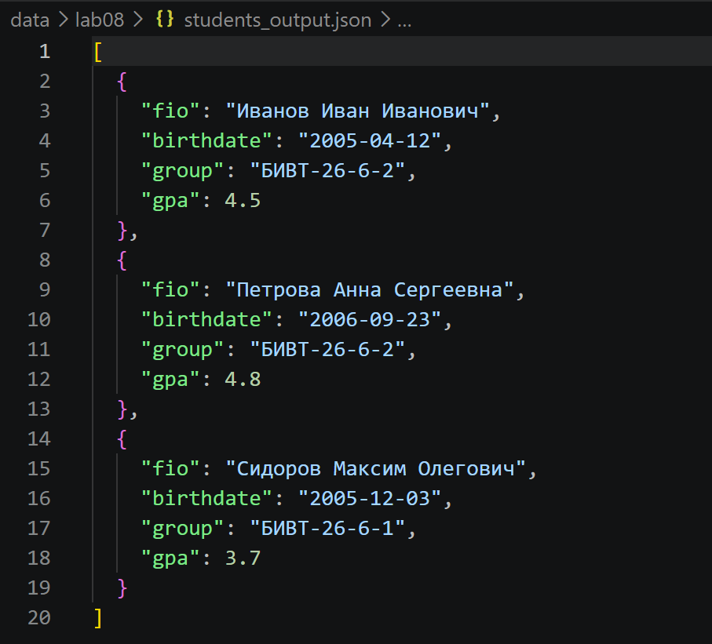
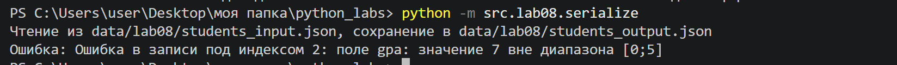
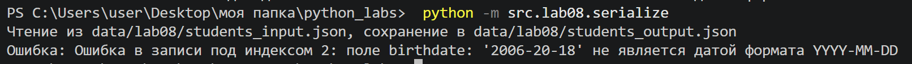

# Лабораторная работа №8

## Задание А модуль models.py


``` python
    from datetime import date

    STUDENT_FIELDS = ("fio", "birthdate", "group", "gpa")


    def check_fio(value):
        """fio: строка, после strip() не пустая."""
        if not isinstance(value, str):
            raise ValueError(f"получено {type(value)}. ожидается строка")
        if not value.strip():
            raise ValueError(f": строка не должна быть пустой")
    

    def check_birthdate(value):
        """birthdate: строка YYYY-MM-DD, существующая дата, не в будущем."""
        if not isinstance(value, str):
            raise ValueError("поле birthdate: ожидается строка формата YYYY-MM-DD")
        if not value.strip():
            raise ValueError('birthdate: не должно быть пустым')
        
        try:
            d = date.fromisoformat(value)
        except ValueError:
            raise ValueError(f"поле birthdate: '{value}' не является датой формата YYYY-MM-DD")
        if d > date.today():
            raise ValueError(f"поле birthdate: дата '{value}' в будущем")
    

    def check_gpa(value):
        """gpa: int или float, 0 <= gpa <= 5."""
        if isinstance(value,bool) or not isinstance(value, (int, float)):
            raise ValueError("поле gpa: ожидается число (int или float)")
        if not (0 <= value <= 5):
            raise ValueError(f"поле gpa: значение {value} вне диапазона [0;5]")


    def check_group(value):
        if not isinstance(value,str):
            raise ValueError("group: ожидается строка")
        if not value.strip():
            raise ValueError("group: не должно быть пустым")
    

    def make_student(fio, birthdate, group, gpa):
        """Собирает запись студента, проверяя каждое поле."""
        check_fio(fio)
        check_birthdate(birthdate)
        check_group(group)
        check_gpa(gpa)

        return {
            'fio': fio.strip(),
            'birthdate': birthdate,
            'group': group.strip(),
            'gpa': float(gpa),
        }
        

    def validate_student(rec):
        """Проверяет готовую запись: набор ключей и значения. При ошибке - ValueError."""

        if not isinstance(rec, dict):
            raise ValueError("запись должна быть словарём")
        
        if set(rec) != set(STUDENT_FIELDS):

            missing = set(STUDENT_FIELDS) - set(rec)
            extra = set(rec) - set(STUDENT_FIELDS)

            raise ValueError(f"неверный набор ключей: нет {sorted(missing)}, лишние {sorted(extra)}")
        
        check_fio(rec["fio"])
        check_birthdate(rec["birthdate"])
        check_group(rec["group"])
        check_gpa(rec["gpa"])


    def student_age(rec, today=None):
        """Вычисляет полных лет на дату (по умолчанию сегодня)."""
        born = date.fromisoformat(rec["birthdate"])
        today = today or date.today()
        age = today.year - born.year
        if (today.month, today.day) < (born.month, born.day):  
            age -= 1
        return age


    def format_student(rec):
        """Выводит фамилию с инициалами, группу, возраст и средний балл."""
        parts = rec["fio"].split()
        initials = "".join(part[0].upper() + "." for part in parts[1:])
        second_name = parts[0]
        if initials:
            second_name += " " + initials
        age = student_age(rec)

        if 11 <= age % 100 <= 14:
            rez = "лет"
        elif age % 10 == 1:
            rez = "год"
        elif 2 <= age % 10 <= 4:
            rez = "года"
        else:
            rez = "лет"

        return f"{second_name} ({rec['group']}), {age} {rez}, GPA {rec['gpa']:.2f}"


    def student_to_dict(rec: dict):
        """Возвращает отдельную копию проверенной записи для сериализации."""
        validate_student(rec)
        return {key: rec[key] for key in STUDENT_FIELDS}


    def student_from_dict(d):
        """Десериализация: берёт ровно нужные ключи, gpa приводит к float, валидирует."""
        if not isinstance(d, dict):
            raise ValueError("запись должна быть словарём")
        for key in STUDENT_FIELDS:
            if key not in d:
                raise ValueError(f"отсутствует поле {key}")

        if isinstance(d["gpa"], bool):
            raise ValueError("gpa: значение bool не допускается")
        try:
            gpa = float(d["gpa"])
        except (ValueError, TypeError):
            raise ValueError(f"gpa: некорректное значение {d['gpa']}")
        
        return make_student(d["fio"], d["birthdate"], d["group"], gpa)
```


**Структура записи `Student`** :

| Поле | Тип | Описание |
|---|---|---|
| `fio` | `str` | ФИО, непустая строка |
| `birthdate` | `str` | дата `YYYY-MM-DD`, существует и не в будущем |
| `group` | `str` | группа, например `БИВТ-26-6-2`, непустая строка |
| `gpa` | `float` | средний балл [0; 5] (`int` приводится к `float`) |


### Логика функций

- **Вспомогательные функции `check_fio`, `check_birthdate`, `check_group`, `check_gpa`:** отвечают за проверку отдельных полей записи студента. При обнаружении некорректного значения вызывают `ValueError` с описанием причины ошибки. Проверки используются при создании и валидации записей.

- **`make_student`:** выполняет проверку всех переданных значений и формирует словарь с данными студента. Строковые поля очищаются от лишних пробелов с помощью `strip()`, а значение `gpa` преобразуется в тип `float`. Для проверки даты применяется `date.fromisoformat`, также исключается возможность передачи `bool` вместо числовой оценки.

- **`validate_student`:** проверяет корректность уже существующей записи. Сначала контролируется соответствие набора ключей константе `STUDENT_FIELDS`: определяются отсутствующие и лишние поля. Затем проверяются значения каждого атрибута с помощью вспомогательных функций.

- **`student_age`:** определяет полный возраст студента на текущую дату. При расчёте учитывается, наступил ли день рождения в текущем году. Параметр `today` позволяет передать конкретную дату для проверки результата.

- **`format_student`:** преобразует данные студента в удобную для чтения строку. В ней отображаются фамилия с инициалами, учебная группа, возраст и средний балл GPA, округлённый до двух знаков после запятой.

- **`student_to_dict`:** выполняет проверку переданной записи и возвращает её копию в виде нового словаря, не изменяя исходный объект.

- **`student_from_dict`:** получает данные студента из словаря, проверяет наличие всех обязательных ключей и передаёт необходимые значения в `make_student`. Дополнительные ключи не учитываются. Проверка значений и преобразование `gpa` выполняются внутри `make_student`.


### Пример запуска:

    python -m src.lab08.models

```python
    if __name__ == "__main__":

        student = make_student("Шилова Дарья Александровна", "2009-03-26", "БИВТ-26-6-2", 4)
        print("Создан студент:", student)

        print("Форматирование:", format_student(student))

        print("Возраст:", student_age(student))

        print("Попытка создать студента с неверным GPA")
        try:
            make_student("Иванов Иван Иванович", "2007-05-14", "БИВТ-26-6-2", 7)
        except ValueError as e:
            print(f"Перехвачена ожидаемая ошибка: {e}")
```
#### Результат:




## Задание B serialize.py

```python
    import json
    from pathlib import Path
    from src.lab04.io_txt_csv import read_text
    from src.lab08.models import student_to_dict, student_from_dict


    def students_to_json(students, path):
    """Сохраняет список записей в JSON (массив объектов)."""
        data = [student_to_dict(s) for s in students]
        Path(path).parent.mkdir(parents=True, exist_ok=True)
        with open(path, "w", encoding="utf-8") as f:
            json.dump(data, f, ensure_ascii=False, indent=2)


    def students_from_json(path) -> list[dict]:

        '''Загружает данные о студентах из JSON с валидацией каждой записи. Первая битая запись 
        вызывает ValueError с номером записи и причиной.
        '''

        text = read_text(path).strip()
        if not text:
            raise ValueError(f"Получен пустой файл {path} ")
        
        try:
            data = json.loads(text)
        except json.JSONDecodeError as error:
            raise ValueError(f"Некорректные данные в файле {path}: {error}") from error

        if not isinstance(data, list):
            raise ValueError(f'Содержимое файла должно быть списком. Получено: {type(data)}')

        students = []
        for i, item in enumerate(data, 1):
            try:
                students.append(student_from_dict(item))
            except ValueError as e:
                raise ValueError(
                    f'Ошибка в записи под индексом {i}: {e}'
                ) from e

        return students
```


### Логика функций:

- **`students_to_json`:** проверяет записи через `student_to_dict` и сохраняет их в JSON-файл в виде массива объектов с параметрами `ensure_ascii=False` и `indent=2`. При необходимости создаёт папку для файла.

- **`students_from_json`:** считывает содержимое файла, проверяет его на пустоту, корректность JSON и наличие массива записей. Каждую запись проверяет через `student_from_dict`.

- **Политика обработки ошибок:** выбрана **`strict`**. При первой некорректной записи программа останавливается и выдаёт `ValueError` с номером записи и причиной ошибки.


### Пример запуска:

    python -m src.lab08.serialize
```python
    if __name__ == '__main__':

        # Чтение и сохранение данных
        print(f'Чтение из data/lab08/students_input.json, сохранение в data/lab08/students_output.json')
        
        try:
            students_list = students_from_json('data/lab08/students_input.json')
            print(f'Успешно загружено записей: {len(students_list)}')
            students_to_json(students_list, 'data/lab08/students_output.json')
        except ValueError as e:
            print(f'Ошибка: {e}')


        # Проверка обработки некорректного файла
        try:
            students_from_json('data/lab08/students_bad.json')
        except ValueError as e:
            print(f'Ошибка: {e}')
```

#### Результат:

- Записи читаются из data/lab08/students_input.json, проходят валидацию через student_from_dict и сохраняются в data/lab08/students_output.json. Ошибок нет, содержимое output совпадает с input.



- Запись с gpa = 7 Запись с gpa = 7 выходит за допустимый диапазон 0 <= gpa <= 5. Чтение останавливается на ней, выводится номер записи и причина.



- Запись с неверной датой. Чтение останавливается на этой записи (политика strict), в консоль выводится номер записи и причина.


